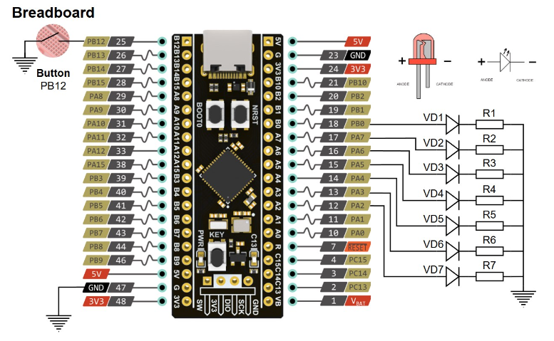
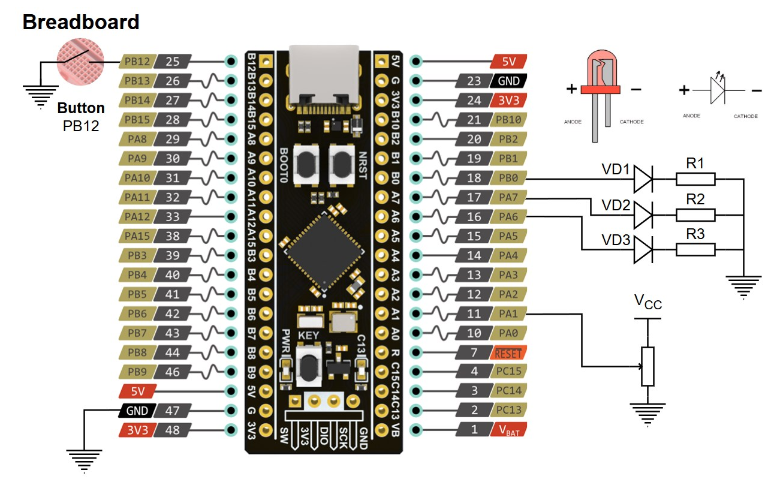

[**lab1**](lab1)

1. Программа для последовательного зажигания семи светодиодов VDi; светодиоды переключаются каждые 0.25 секунды (250 мс); 
2. Направление последовательности зажигания светодиодов – либо VD1 → VD7, либо VD7 → VD1 – задаётся нажатием на кнопку Button (вывод PB12 МК).
Программа сохраняет работоспособность при настройке частоты тактирования МК на HSI, HSE и PLL.

[**lab2**](lab2)

1. Добавлен функционал гашения дребезга нажатия на кнопку Button с помощью таймера/счётчика TIM4 в код лабораторной работы;
2. Программа для управления яркостью свечения светодиодов VDi (ШИМ); яркость свечения задаётся с помощью потенциометра VR2, подключённого к каналу ADC1_IN1 (вывод PA1); выбор регулируемого светодиода осуществляется нажатием на кнопку Button (также с гашением дребезга).
Программа сохраняет работоспособность при настройке частоты тактирования на HSI, HSE и PLL.

