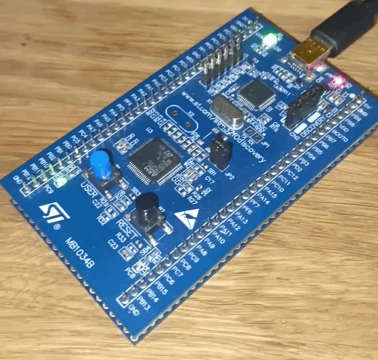

Учебный проект с прошивкой платы через openocd. Код для платы взят из репозитория https://github.com/dwelch67/stm32f0d. Программа мигает двумя диодами на PC8 и PC9.




Платформа WSL2 под Windows, Ubuntu
1) Установка openocd, arm-none-eabi:
```bash
sudo apt install openocd
sudo apt install gcc-arm-none-eabi
```
2) Сборка make файла и запуск сервера openocd:
```bash
make
sudo openocd -f interface/stlink.cfg -f target/stm32f0x.cfg
// Open On-Chip Debugger 0.12.0
// Licensed under GNU GPL v2
// For bug reports, read
//        http://openocd.org/doc/doxygen/bugs.html
// Info : auto-selecting first available session transport "hla_swd". To override use 'transport select 
// <transport>'.
// Info : The selected transport took over low-level target control. The results might differ compared to 
// plain JTAG/SWD
// Info : Listening on port 6666 for tcl connections
// Info : Listening on port 4444 for telnet connections
// Info : clock speed 1000 kHz
// Info : STLINK V2J48S0 (API v2) VID:PID 0483:3748
// Info : Target voltage: 2.901535
// Info : [stm32f0x.cpu] Cortex-M0 r0p0 processor detected
// Info : [stm32f0x.cpu] target has 4 breakpoints, 2 watchpoints
// Info : starting gdb server for stm32f0x.cpu on 3333
// Info : Listening on port 3333 for gdb connections
// Info : accepting 'telnet' connection on tcp/4444
```
3) С другого терминала подключение по telnet:
```bash
telnet localhost 4444
- Прошивка в SRAM
>reset halt
>load_image /home/kirill/stm32f0d/blinker01/sram/blinker01.gcc.thumb.elf
// 220 bytes written at address 0x20000000
// downloaded 220 bytes in 0.004524s (47.490 KiB/s)
>resume 0x20000000

- Прошивка во FLASH
>reset halt
>flash write_image erase /home/kirill/stm32f0d/blinker01/flash/blinker01.gcc.thumb.elf
// Adding extra erase range, 0x08000114 .. 0x080003ff
// auto erase enabled
// wrote 276 bytes from file /home/kirill/stm32f0d/blinker01/flash/blinker01.gcc.thumb.elf in 0.089145s 
// (3.024 KiB/s)
>reset
```